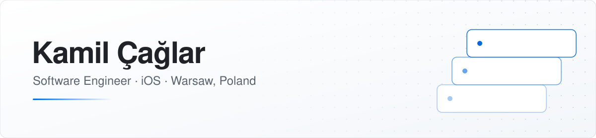

<picture>
  <source media="(prefers-color-scheme: dark)" srcset="assets/banner-dark.svg">
  <source media="(prefers-color-scheme: light)" srcset="assets/banner-light.svg">
  
</picture>

I'm a software engineer based in Warsaw, specializing in iOS. At **[OLX](https://www.olx.pl)**, I build and ship production features across native iOS and Flutter.

My work spans UI, modular architecture, API integration and release delivery. Alongside my professional work, I develop independent mobile products, with a focus on useful features and maintainable software.

[LinkedIn](https://www.linkedin.com/in/kamil-caglar/)

---

## At OLX

- Develop features in **Swift**, **SwiftUI** and **UIKit**, using **The Composable Architecture (TCA)** and modules organized with **Swift Package Manager**.
- Connect native iOS and **Flutter / Dart** modules through **Pigeon**, working with cross-platform engineers.
- Integrate **REST APIs** and work on debugging, code reviews and maintainability.
- Work with **Bitrise CI/CD**, release coordination and the **App Store release process**.

## Published Apps

**[Fitly – AI Outfit & Wardrobe](https://apps.apple.com/pl/app/fitly-ai-outfit-wardrobe/id6762230273)**  
A digital wardrobe and outfit planner with background removal, saved looks and AI-powered styling.

**[Mio – Couples Questions](https://apps.apple.com/us/app/mio-couples-questions/id6787413123)**  
An offline iOS app with conversation decks and question cards to help couples connect.

Both apps are independently developed and available on the App Store.
